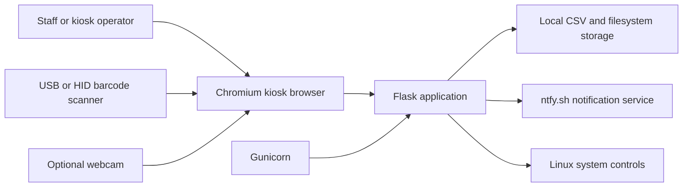
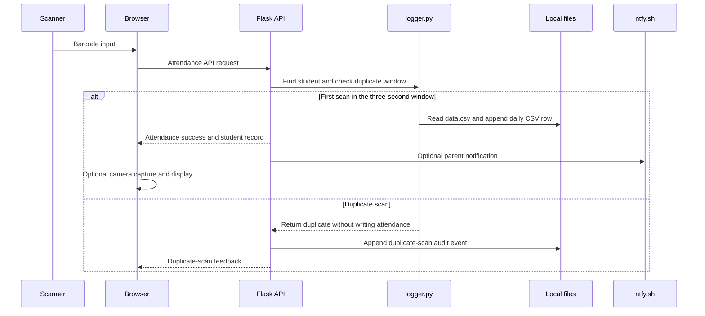

# CVAFPI Identification System Architecture

## Purpose

The CVAFPI Identification System is a Linux kiosk application for barcode-based attendance and access verification. It provides a browser-based operations console for scanning IDs, managing student records, reviewing attendance logs, importing CSV data, configuring branding and notifications, and performing protected kiosk controls.

The application is primarily a Flask application backed by CSV files and the local filesystem. It is designed to run on one kiosk computer, with optional outbound notifications through ntfy.sh.

## System Context



## Runtime Components

### Flask application: `app.py`

`app.py` owns the application and HTTP API:

- Serves the HTML pages in `templates/` and assets in `static/`.
- Exposes page routes for the launchpad, scanner, student manager, log manager, and migration UI.
- Exposes JSON APIs for attendance, student records, log retrieval, settings, branding, security, notifications, and kiosk system actions. It also serves the root-level JsBarcode bundle at `/jsbarcode.js` for the scanner page.
- Loads configuration from `settings.json` and uses `CVAFPI_DATA_DIR` as the writable data root when set.
- Delegates CSV, attendance-log, audit, and cleanup operations to `logger.py`.
- Sends parent and office notifications asynchronously through HTTPS requests to ntfy.sh.

### WSGI entry point: `wsgi.py`

`wsgi.py` imports and exposes `app` from `app.py`. Production startup uses this module with Gunicorn:

```bash
gunicorn --bind 0.0.0.0:5000 --workers 1 --threads 4 --timeout 120 wsgi:app
```

The single-worker configuration is important because the application writes shared CSV files directly and is intended for one kiosk instance.

### File and log service: `logger.py`

`logger.py` is the persistence and maintenance module. It:

- Reads and writes the primary student registry in `data.csv`.
- Mirrors student writes to `backup-data.csv`.
- Creates one attendance directory per day under `CVA_Database/`.
- Appends attendance rows to `CVA_Database/logs_YYYY-MM-DD/logs_YYYY-MM-DD.csv`.
- Writes administrative and security events to `logs/audit_events.csv`.
- Parses and validates uploaded student CSV files for preview, merge, or replacement imports.
- Runs seven-day cleanup at module initialization and removes expired dated log directories, including snapshots stored there.

### Browser UI

The HTML pages are server-rendered by Flask and use browser-side JavaScript for API calls and interaction:

- `launchpad.html`: operations console and protected system controls, with an external internet-reachability indicator.
- `scanner.html`: barcode attendance workflow, duplicate-scan feedback, search-mode recovery, and optional camera capture.
- `manager.html`: student record administration and notification-topic generation using the configurable school prefix.
- `logs-manager.html`: attendance and protected audit-event review, including snapshots, filtering, and CSV-safe filtered exports.
- `audit-manager.html`: dedicated protected audit-event and blocked-camera snapshot review.
- `migration.html`: CSV validation, preview, merge, and replacement import.
- `kiosk-dialog.js` and `kiosk-dialog.css`: shared kiosk dialogs, passcode validation, and safe handling of non-JSON API responses.
- `ping.js`: periodically checks external internet reachability through Cloudflare's trace endpoint. It does not check whether the local Flask API is healthy.
- `notification-prefix.js`: loads, derives, and saves the configurable notification-topic prefix through the existing JSON settings API.

`jsbarcode.js` provides offline barcode rendering for the UI.

### Auxiliary Node server: `server.js`

`server.js` is a separate Express server on port 3000 by default. It serves project files and contains simple endpoints for CSV log listing and viewing. The documented production launcher uses Flask/Gunicorn on port 5000, so the Node server should be treated as an auxiliary or legacy server unless an operator explicitly starts it.

### Debian package

`build-deb.sh` creates an architecture-independent package with `dpkg-deb`. The package installs read-only application code and assets under `/usr/share/idbiosys`, a desktop entry, and `idbiosys-kiosk`. Apt supplies Python, Flask, Pillow, Gunicorn, and desktop-opening dependencies from configured repositories. No local CSV data, settings, logs, or custom logo are packaged.

The desktop launcher starts one Gunicorn process as the signed-in user, bound to `127.0.0.1:5000`, then opens Chromium kiosk mode or the default browser. It stores that user's writable data under `${XDG_DATA_HOME:-~/.local/share}/idbiosys` and its server log under `${XDG_STATE_HOME:-~/.local/state}/idbiosys`. The package does not install a system service or change sudo policy. Custom logos are served from the user data directory rather than copied into read-only package assets.

## Request and Data Flows

### Attendance scan



The logger uses a process-local lock and monotonic three-second window per barcode to reject rapid repeat scans. A duplicate is not written to the attendance CSV and is recorded in the audit CSV. The lock coordinates threads in one process; it is not a distributed lock, so the supported Gunicorn configuration remains one worker.

Successful attendance rows store the timestamp, barcode, student details, access type, color, and a generated snapshot filename. The snapshot itself is stored in the corresponding dated database directory when camera capture is enabled.

### Student registry updates

The registry is a CSV-backed map keyed by barcode. Manager operations and migration imports load the current records, apply changes in memory, then rewrite both `data.csv` and `backup-data.csv` with the common schema:

```text
BARCODE,NAME,GRADE,SECTION,ACCESS,COLOR,NTFY_TOPIC
```

CSV imports accept `BARCODE` and `NAME` as required headers, with optional student fields. Preview reports invalid rows and samples; barcode, name, grade, section, access, and topic values are limited to 100 characters, and badge colors must use `#RRGGBB` format. Imports reject any invalid rows and reject empty files, including empty replacement imports, before modifying the roster. There is no relational database, ORM, or external persistence service. Concurrent manual edits to the CSV files while the server is active are unsupported.

### Settings and branding

`settings.json` stores feature flags, institution branding, the notification-topic prefix, notification topics, command barcodes, and security metadata. If the prefix is unset, it is derived from the institution name; the student manager uses it for generated student notification topics, while page titles use it as a branding label. Public settings APIs exclude password hashes and salts. A custom logo is stored as `static/custom-logo.png` under the configured data root and served through `/branding/custom-logo.png`, so the uploaded image does not need to modify read-only application assets.

## Security Boundaries

- Protected actions require the configured passcode, including system controls and sensitive administration operations.
- Passcodes and security answers are stored as PBKDF2-HMAC-SHA256 hashes with per-value salts.
- Public settings responses exclude `pin_hash`, `pin_salt`, `security_answer_hash`, and `security_answer_salt`.
- Uploaded and imported CSV data is validated before import; required fields include `BARCODE` and `NAME`.
- The launchpad's connectivity indicator contacts an external endpoint and reports internet reachability only; it does not report local application/API health.
- Log filename lookup in the Node server is reduced to a basename before constructing a path.
- Kiosk command barcodes can invoke shutdown, restart, exit, or navigation actions, so printed command barcodes must be physically controlled.
- Notification topics and tokens are operational secrets and must not be committed or exposed.
- The kiosk account may require passwordless sudo for hardware and system actions; this is a deployment risk that should be limited to the dedicated kiosk environment.

## Storage Layout

```text
BASE_DIR/
├── data.csv                         Primary student registry
├── backup-data.csv                 Mirrored student registry
├── settings.json                   Runtime settings and security metadata
├── logs/
│   └── audit_events.csv            Administrative and security audit events
├── CVA_Database/
│   └── logs_YYYY-MM-DD/
│       ├── logs_YYYY-MM-DD.csv     Daily attendance records
│       └── *.jpg                   Optional scan snapshots
└── static/
    └── custom-logo.png             Optional uploaded institution logo
```

`BASE_DIR` defaults to the project directory and can be changed with the `CVAFPI_DATA_DIR` environment variable. The source templates and static assets remain available through the application resource directory, which also supports packaged execution through `sys._MEIPASS`.

## Deployment and Operations

1. Install the Python dependencies from `requirements.txt` in a fresh virtual environment, or install the generated `.deb` with apt to use Debian-managed dependencies.
2. Use the project launcher (`CVAFPI IDENTIFICATION SYSTEM.sh`), run `idbiosys-kiosk` from a Debian package installation, or start Gunicorn through `wsgi:app`.
3. Run the kiosk browser against the Flask service on port 5000. The package launcher binds to localhost and runs only for the desktop session.
4. Keep the kiosk on a trusted, preferably wired network.
5. Use the web migration and manager interfaces for registry changes while the server is running.
6. Monitor `logs/audit_events.csv` and the dated attendance directories for operational issues.
7. Keep regular copies of `data.csv`, `backup-data.csv`, `settings.json`, and required logs according to the institution's retention policy.

## Architectural Constraints and Risks

- CSV and filesystem writes are simple and transparent but are not suitable for multi-kiosk concurrent writes or high-volume multi-user deployments.
- The single Gunicorn worker reduces write races but does not provide a distributed locking or transaction mechanism.
- The application has no built-in authentication session layer; authorization is implemented with passcode checks on protected requests.
- ntfy.sh is an external dependency for notifications. Attendance recording should remain local if notification delivery fails.
- Seven-day cleanup is executed when `logger.py` is imported, so retention depends on the application process starting regularly.
- `server.js` and Flask expose overlapping file-serving concepts. Operators should choose one documented runtime path rather than running both as interchangeable production servers.

## Extension Guidelines

When extending the system:

- Keep persistence changes in `logger.py` and route/request orchestration in `app.py`.
- Preserve the student CSV schema and update both primary and backup files for registry writes.
- Add audit events for security-sensitive or administrative operations.
- Do not return secret settings through public APIs.
- Keep browser pages dependent on stable Flask API contracts rather than reading storage files directly.
- Add focused tests around CSV parsing, import modes, passcode protection, cleanup, and attendance logging when changing those behaviors.
