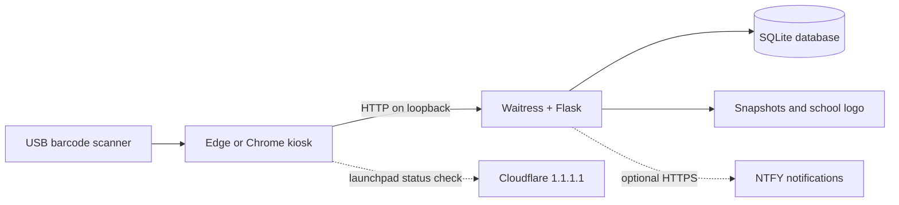

# CVAFPI Identification System

<br clear="left"/>

CVAIDSYS is a local-first school identification and attendance kiosk for Windows 11 (64-bit). A USB barcode scanner sends student IDs to the local web app; Flask and Waitress process scans, and SQLite stores student, attendance, settings, and audit records. Optional features include webcam snapshots, NTFY notifications, CSV import, school branding, themes, and passcode-protected controls.

The supported kiosk launch listens on `127.0.0.1`; it is designed for one computer, not as a public website or shared network service. Student and attendance data stay local unless an operator enables a notification. When the launchpad is open, its separate connectivity indicator checks Cloudflare's `1.1.1.1` endpoint every five seconds and sends no student data.

## At a glance

| Area | Current behavior |
| --- | --- |
| Interface | Launchpad, scanner, student manager, logs, audit viewer, and CSV migration pages |
| Runtime | Flask application served by Waitress; Edge is preferred, Chrome is the fallback |
| Storage | SQLite database and backup, plus local snapshot and logo files |
| Scanner | USB keyboard-wedge scanner or manual barcode entry |
| Network | Optional outbound HTTPS for NTFY; launchpad reachability check to Cloudflare |
| Windows package | Single-file PyInstaller executable; optional Inno Setup installer |



## Scan flow

The scanner page submits each barcode to the local API. A known student is recorded with the scan time; if camera capture is enabled, an optional snapshot is saved locally. The API applies a separate three-second duplicate window to each barcode. A duplicate creates an audit event, not another attendance row. An unknown barcode is rejected, shown in the scanner, and recorded in Audit Events.

If parent notifications are enabled and the student has a topic, the app sends the student's name and scan time to that topic on `ntfy.sh` in the background. Camera-blocked office alerts are a separate optional notification. Anyone who knows a public NTFY topic can subscribe to it; use private topic names and consider the data shared with the notification service.

## Windows requirements

- Windows 11 64-bit
- Python 3.11 or newer for development. The Windows build script can install Python automatically.
- Microsoft Edge or Google Chrome
- A USB barcode scanner that behaves as a keyboard
- A webcam if scan photos are enabled

The packaged application does not require Python. The browser is required because the interface runs in locked browser kiosk mode.

## Before building

Complete this checklist on a Windows 11 test computer before creating the final executable:

- Confirm the computer has Edge or Chrome and network access for build dependencies (and NTFY if used). If Python 3.11 or newer is not installed, the build script installs it from the included Python Install Manager MSIX.
- Run the server-only test described below and open every page: launchpad, scanner, manager, logs manager, Audit Manager, migration, and settings.
- Add one test student with a unique barcode and an NTFY topic. Scan the barcode and verify the attendance row, timestamp, saved snapshot if the camera is enabled, and the parent notification.
- Test a student without a topic, with parent notifications disabled, and with an unknown barcode. None of these should send a parent notification.
- Test CSV preview/import, log viewing/export, logo upload, passcode setup/recovery, and the configured system barcodes.
- Test an unknown barcode. Confirm that it is not added to attendance, appears as a scan error in the scanner card, and is visible in Audit Events.
- Scan barcode A, then B, then A again within three seconds. Confirm A and B each have one attendance row and the second A appears as a `dual_scan` event in Audit Manager. Confirm another A is accepted after its three-second window expires.
- Test an application restart with a valid database backup, then verify the database opens normally. Test recovery only on a disposable copy of the data.
- Back up `CVA_Database`, `logs`, and `static\custom-logo.png` before packaging.

The Linux development environment can check Python code and server routes, but it cannot produce a Windows executable. The final build must run on Windows 11.

## Build one executable

Build on Windows 11. PyInstaller creates Windows executables and cannot cross-compile a Windows binary from Debian or Linux. Keep `python-manager-26.3.msix` beside `build-windows.bat`; if a compatible 64-bit Python is not already installed, the script installs the Python Install Manager MSIX and Python 3.11 automatically. Network access is needed to download Python and build dependencies.

1. Copy or clone this repository, including `python-manager-26.3.msix`, to the Windows computer.
2. Double-click `build-windows.bat`.
3. Run `dist\CVAFPI-IDSYS.exe`.

The build script creates a temporary `.venv-windows` environment, installs the Windows dependencies, and builds a single file. The final executable is:

```text
dist\CVAFPI-IDSYS.exe
```

No Python installation is needed on the deployment computer after the executable has been built.

## Build the installer

Install Inno Setup 6, build `dist\CVAFPI-IDSYS.exe` with `build-windows.bat`, then compile the installer script from the repository root:

```text
ISCC.exe CVAFPI-IDSYS.iss
```

The installer is written to `installer-output\CVAFPI-IDSYS-Setup.exe`. It installs the kiosk executable under Program Files and adds Start Menu shortcuts, including a Licenses submenu with the combined notices and individual license files. Per-user database, settings, and logs are stored under `%LOCALAPPDATA%\CVAFPI` and are not removed by uninstall.

### Set the shortcut icon in Windows 11

The installer includes [CVAIDSYSLOGO.ico](CVAIDSYSLOGO.ico) in the installation folder, normally `C:\Program Files\CVAFPI Identification System\CVAIDSYSLOGO.ico`. Program Files is a protected folder, so copy the icon rather than moving it. To keep it easy to find, save a copy under your user profile, for example:

```text
%USERPROFILE%\Pictures\CVAFPI\CVAIDSYSLOGO.ico
```

Create the `CVAFPI` folder if needed. If you do not have the installer files available, download `CVAIDSYSLOGO.ico` from this repository and save it to that same folder.

To set the icon on the Start Menu shortcut:

1. Open Start and search for `CVAFPI Identification System`.
2. Right-click the result and select **Open file location**.
3. In File Explorer, right-click the CVAFPI shortcut and select **Properties**. If the compact Windows 11 menu is shown, select **Show more options** first.
4. On the **Shortcut** tab, select **Change Icon**, then **Browse**.
5. Open the copy of `CVAIDSYSLOGO.ico` in your user Pictures folder, select it, and confirm with **OK**.
6. Select **Apply**, then **OK**.

To make a desktop shortcut, copy the Start Menu shortcut and paste it onto the desktop; set its icon using the same steps. This changes the shortcut icon, not the Edge or Chrome window used while the kiosk is running. If the app is already pinned to Start or the taskbar, unpin and pin the updated shortcut again to refresh the pinned icon.

## Server-only development run

Use Python 3.11 or newer. From the repository root, create a virtual environment:

```bash
python -m venv .venv
```

Activate it with `.venv\Scripts\Activate.ps1` in Windows PowerShell or `source .venv/bin/activate` on Linux/macOS, then install the project dependencies:

```bash
python -m pip install -r requirements-windows.txt
```

To inspect the application in a normal browser without opening kiosk mode, run:

```text
python -m waitress --listen=127.0.0.1:8080 wsgi:app
```

The server listens on `http://127.0.0.1:8080`. Open that address and test the pages and APIs. To use another port:

```text
python -m waitress --listen=127.0.0.1:5050 wsgi:app
```

For a quick Python-only route check, run `python -m py_compile app.py logger.py windows_launcher.py wsgi.py`.

Run the existing tests with:

```bash
python -m unittest discover -s tests -v
```

For a direct local run, use the application entry point:

```text
python app.py
```

This starts Waitress on `http://127.0.0.1:5000` (or the port set by `CVAFPI_PORT`). The server remains bound to the local computer. The WSGI callable is available as `wsgi:app` for Waitress commands and other WSGI tooling.

## Kiosk mode

Starting `CVAFPI-IDSYS.exe` will:

1. Start the local Waitress WSGI server on `127.0.0.1:5000`.
2. Open Microsoft Edge or Chrome using fullscreen kiosk mode.
3. Use a dedicated `.kiosk-profile` browser profile so an existing personal browser session is not reused.
4. Keep the application local to the computer; it is not exposed to the network.

Edge is preferred when installed. Chrome is used as a fallback. If neither browser is installed, the executable reports that a kiosk browser is required.

The kiosk controls are passcode-protected. A passcode must contain 4 to 12 non-space characters; letters, numbers, and symbols are supported. `Exit kiosk mode` closes only the browser process started by this application. It does not close other Edge or Chrome windows.

The scanner also supports protected quick-access barcodes:

- `DataManagerCVAFPI8%/?` opens Student Manager.
- `LogManagerCVAFPI34#%` opens Logs & Audit Trail.
- `SettingsCVAFPI8&5?` opens the System Settings modal.

These values can be changed in the `System barcodes` section of Settings. Quick-access commands require the configured passcode before redirecting.

For the strongest Windows lockdown, configure Windows Assigned Access or Shell Launcher for the account used by the kiosk. Browser kiosk mode controls the application window, while Assigned Access controls the Windows desktop and keyboard escape paths.

## Development run

On Windows, `run-windows.bat` starts the server and kiosk browser using `.venv-windows`. The environment and dependencies are created by `build-windows.bat`; if you do not want to build the executable, create `.venv-windows` and install `requirements-windows.txt` first.

```text
run-windows.bat
```

This starts the same server and browser kiosk launcher from `.venv-windows`.

The launcher serves the Flask application through Waitress `2.1.1` instead of Flask's development server.

## Notifications

### Parent notifications

Parent notifications are controlled by the `Parent notifications` setting and a topic on each student record. A successful scan sends a message such as `Student Name checked in at 09/13/2026 08:30:00 AM.` to `https://ntfy.sh/<topic>`. A blank topic or `None` skips the notification. Notification delivery happens in the background so a slow internet connection does not block the scanner.

Use unique, private topic names. Anyone who knows an NTFY topic can subscribe to it. For stronger privacy, use an authenticated NTFY server and extend the configuration before deployment.

### Office alerts

Office alerts use the configured office topic for camera-blocked alerts. They are separate from parent notifications and can be enabled independently.

## Scanner errors and audit events

An unrecognized barcode returns a scan error and is not inserted into the attendance table. The scanner keeps focus available and shows the barcode, error message, timestamp, and red `ERROR` badge in the last-scanned card. Staff can then add the missing student in Student Manager. When staff focus the log search field, the scanner shows a temporary search-mode notice; selecting the barcode field resumes scanning and dismisses the notice without requiring its button.

The passcode-protected **Audit Manager** is available from Data administration. It records invalid scans, duplicate scans, successful scans, blocked-camera alerts, settings failures and saves, invalid passcode attempts, student changes, CSV imports, and database recovery events. When a blocked-camera request includes an image, the event links to its saved snapshot. The Logs Manager also retains its Audit Events view.

A duplicate scan is recorded with event type `dual_scan` and its barcode. It does not create an attendance row or trigger a parent notification. The server enforces a separate three-second window for each barcode, so scanning another ID does not clear the first ID's window.

Audit records are stored in SQLite and included in the automatic database backups.

## Student CSV imports

The migration page previews a CSV before import. Column names are case-insensitive; `BARCODE` and `NAME` are required. The other fields are optional:

| Column | Default when omitted | Validation |
| --- | --- | --- |
| `GRADE`, `SECTION` | Blank | Up to 100 characters |
| `ACCESS` | `REGULAR` | Up to 100 characters |
| `COLOR` | `#059669` | Six-digit hex color, such as `#059669` |
| `TOPIC` | `None` | Up to 100 characters; blank/`None` suppresses parent notifications |

Barcode and name are required for every row and are limited to 100 characters. Invalid rows prevent the import from being applied; a failed import does not leave a partial student list. Existing barcodes are updated unless the replace-existing option is selected.

## Data and backup

The following paths are relative to the app's writable data directory:

```text
CVA_Database\cva.sqlite3              Students, attendance, audit, and settings
CVA_Database\cva.sqlite3.backup       Latest SQLite backup
CVA_Database\logs_YYYY-MM-DD\         Scan and blocked-camera snapshots
logs\                                 Auxiliary directory; diagnostics print to the console
static\custom-logo.png               Uploaded school logo
```

The data directory depends on how the app is launched. The installer shortcut sets `CVAFPI_DATA_DIR` to `%LOCALAPPDATA%\CVAFPI`; uninstalling the app does not remove that per-user data. A direct executable run defaults to the executable's directory, while a source run defaults to the repository directory. `CVAFPI_DATA_DIR` can override these defaults.

Settings are stored in the SQLite `app_settings` table and included in the database backup. Any root `settings.json` file is ignored. The SQLite backup does not include snapshots or the uploaded logo.

Stop the kiosk before copying its data. Back up the complete data directory, including the database, snapshots, and custom logo; copying only the executable is not a data backup. Do not edit the SQLite database while the application is running.

The application creates a consistent SQLite backup with SQLite's backup API and replaces the previous backup atomically. On startup, if the primary database cannot be initialized and a backup exists, the app attempts recovery and preserves the original database as `cva.sqlite3.damaged`. If recovery also fails, normal pages are not served and a database error is reported.

## Security controls

Initial passcode setup requires a 4 to 12 character passcode, a security question, and a recovery answer. Letters, numbers, and symbols are supported, but spaces are not. Saving settings opens the shared passcode prompt; an empty or incorrect current passcode cannot save settings once a passcode is configured. Changing the passcode also requires a recovery question and answer. The passcode protects settings, logo uploads, student changes, CSV imports, audit events, kiosk exit, restart, shutdown, and system barcodes. The passcode is stored as a salted PBKDF2-SHA256 hash.

Themes are selected in System Settings and apply to the launchpad, scanner, student manager, logs manager, and migration pages. Supported themes are Night, Light, Grassy, Ocean, and Sunset. Accent colors must be six-digit hexadecimal colors such as `#4da3ff`.

The Windows restart and shutdown controls use the standard Windows `shutdown` command. Do not run the application from an administrator account unless Windows kiosk policy requires it.

## Project structure

- `app.py` - Flask API and application routes
- `wsgi.py` - WSGI application entry point
- `logger.py` - SQLite database and attendance logging
- `windows_launcher.py` - local server and browser kiosk launcher
- `ID-BIO-Project.spec` - single-file PyInstaller configuration
- `build-windows.bat` - Windows build script
- `run-windows.bat` - Windows development launcher
- `templates/` - application pages
- `static/` - packaged interface assets
- `tests/` - database backup and CSV validation tests
- `LICENSE` and `LICENSES/` - project and third-party license notices
- `ARCHITECTURE.md` - technical components, data model, routes, security boundaries, and runtime flows

## Troubleshooting

### The build does not start

If the automatic Python setup fails, run `build-windows.bat` from a Windows command prompt and confirm that the Python launcher is available with:

```text
py --version
```

### The browser does not open

Install Microsoft Edge or Google Chrome, then start the executable again. The application intentionally does not fall back to a normal, unlocked browser window.

### Port 5000 is already in use

Close the other local service using port 5000, then restart the executable. The application uses port 5000 by default.

### Existing records are missing

Copy the previous `CVA_Database`, `logs`, and `static\custom-logo.png` files beside the new executable before starting it.

If the primary database is damaged, stop the application and preserve a copy of `CVA_Database\cva.sqlite3` before restarting. The application will attempt automatic recovery from `CVA_Database\cva.sqlite3.backup`. Review Audit Events after recovery and create a fresh external backup.

### A scan says student not found

The barcode is not present in the student database. Add or update the student in Student Manager, then scan again. The failed scan remains available in Audit Events for staff review.

### Settings will not save

Saving settings opens a passcode prompt. To change the passcode, provide a new passcode, security question, and recovery answer; leave all three blank to keep the existing passcode and recovery details unchanged.

### Parent notification did not arrive

Check that parent notifications are enabled, the student topic is not blank or `None`, the kiosk has internet access, and the topic is spelled exactly the same in the NTFY subscriber and student record. Check the server console for `[ntfy Parent Error]` messages.
